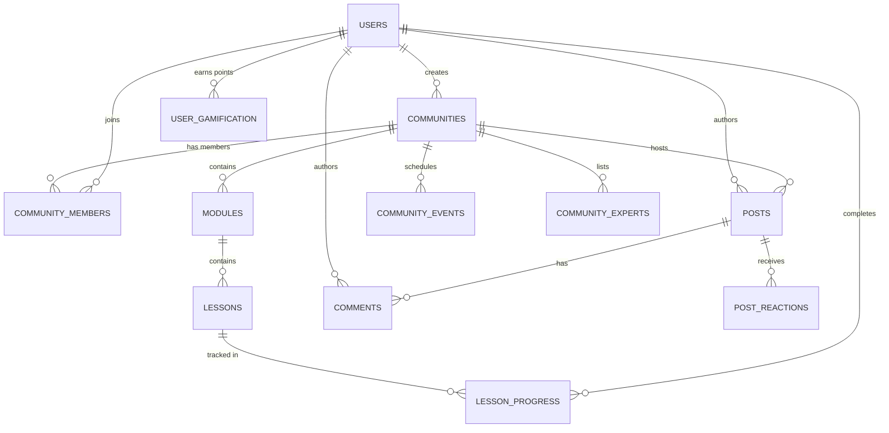

# Akademi Skool-Style Community Architecture & Replication Blueprint
**Document ID:** ARCH-COMM-2026-V1  
**System Type:** Interactive Learning Community, Masterclass Hub & Course Platform  
**Architecture Pattern:** Modular Monolith / Micro-Frontend Ready SPA + REST/WebSocket Backend  

---

## 1. System Overview & Product Concept

The **Akademi Community System** is an all-in-one educational social network modeled after high-retention community platforms (such as Skool and Circle), but deeply unified with **1-on-1 live tutoring, video masterclasses, curriculum management, and tokenized student rewards**.

### Core Value Proposition:
1. **Communities as Products**: Tutors, master instructors, or Akademi itself can launch free or paid subscription communities.
2. **Skool-Style 7-Tab Architecture**:
   - 🗣️ **Community (Feed & Threads)**: Peer discussions, Q&As, project showcases, file uploads, nested comments, and pinned announcements.
   - 📚 **Classroom (Courses & Modules)**: Step-by-step modular lessons (video, PDF, interactive quizzes) with granular completion tracking.
   - 📅 **Events (Live Masterclasses)**: Scheduled live cohort sessions, Q&As, and workshops with 1-click meeting lobby joins and Google Calendar sync.
   - 👨‍🏫 **Experts & Mentors**: Directory of community tutors and TAs with real-time hourly rates in Naira (₦), ratings, and instant 1:1 booking.
   - 🏆 **Leaderboard & Gamification**: 7-day, 30-day, and all-time rankings, levels (Level 1 Novice to Level 9 Grandmaster), streaks, and reward tokens.
   - 🤖 **AI Study Assistant (Maya AI)**: Automated tutor bot trained on the community curriculum for 24/7 instant doubt clearing.
   - ⚙️ **Creator Studio & Admin Desk**: Member management, revenue metrics, post moderation, and curriculum creation tools.

---

## 2. Full Database Schema (PostgreSQL / MySQL / SQLite)

### 2.1 Entity Relationship Diagram (Mermaid)



### 2.2 SQL Table Definitions

```sql
-- 1. Communities Table
CREATE TABLE communities (
    id VARCHAR(64) PRIMARY KEY,
    name VARCHAR(255) NOT NULL,
    slug VARCHAR(255) UNIQUE NOT NULL,
    tagline VARCHAR(255),
    description TEXT,
    category VARCHAR(100) NOT NULL, -- e.g. 'Data & Tech', 'Mathematics & Sciences', 'Languages'
    community_type VARCHAR(50) DEFAULT 'Tutor Masterclass',
    access_type VARCHAR(20) DEFAULT 'paid', -- 'free' | 'paid' | 'invite_only'
    monthly_price DECIMAL(10, 2) DEFAULT 0.00,
    currency VARCHAR(10) DEFAULT 'NGN',
    cover_image_url TEXT,
    avatar_url TEXT,
    creator_id VARCHAR(64) NOT NULL REFERENCES users(id) ON DELETE CASCADE,
    welcome_message TEXT,
    is_verified BOOLEAN DEFAULT FALSE,
    is_archived BOOLEAN DEFAULT FALSE,
    created_at TIMESTAMP WITH TIME ZONE DEFAULT CURRENT_TIMESTAMP,
    updated_at TIMESTAMP WITH TIME ZONE DEFAULT CURRENT_TIMESTAMP
);

-- 2. Community Memberships
CREATE TABLE community_members (
    id VARCHAR(64) PRIMARY KEY,
    community_id VARCHAR(64) NOT NULL REFERENCES communities(id) ON DELETE CASCADE,
    user_id VARCHAR(64) NOT NULL REFERENCES users(id) ON DELETE CASCADE,
    role VARCHAR(30) DEFAULT 'member', -- 'owner' | 'moderator' | 'tutor' | 'member'
    status VARCHAR(30) DEFAULT 'active', -- 'active' | 'suspended' | 'pending_payment'
    membership_plan VARCHAR(30) DEFAULT 'free', -- 'free' | 'monthly_subscription' | 'lifetime'
    subscribed_at TIMESTAMP WITH TIME ZONE DEFAULT CURRENT_TIMESTAMP,
    expires_at TIMESTAMP WITH TIME ZONE,
    points_total INT DEFAULT 0,
    current_level INT DEFAULT 1,
    streak_days INT DEFAULT 0,
    last_active_at TIMESTAMP WITH TIME ZONE DEFAULT CURRENT_TIMESTAMP,
    UNIQUE(community_id, user_id)
);

-- 3. Course Modules
CREATE TABLE community_modules (
    id VARCHAR(64) PRIMARY KEY,
    community_id VARCHAR(64) NOT NULL REFERENCES communities(id) ON DELETE CASCADE,
    title VARCHAR(255) NOT NULL,
    description TEXT,
    order_index INT NOT NULL DEFAULT 0,
    is_published BOOLEAN DEFAULT TRUE,
    created_at TIMESTAMP WITH TIME ZONE DEFAULT CURRENT_TIMESTAMP
);

-- 4. Lessons within Modules
CREATE TABLE community_lessons (
    id VARCHAR(64) PRIMARY KEY,
    module_id VARCHAR(64) NOT NULL REFERENCES community_modules(id) ON DELETE CASCADE,
    title VARCHAR(255) NOT NULL,
    lesson_type VARCHAR(30) DEFAULT 'video', -- 'video' | 'doc' | 'quiz' | 'external_link'
    duration_label VARCHAR(50), -- '15:20', 'PDF', '10 Questions'
    content_text TEXT,
    video_url TEXT,
    attachment_url TEXT,
    order_index INT NOT NULL DEFAULT 0,
    is_free_preview BOOLEAN DEFAULT FALSE,
    created_at TIMESTAMP WITH TIME ZONE DEFAULT CURRENT_TIMESTAMP
);

-- 5. Student Lesson Progress
CREATE TABLE lesson_progress (
    id VARCHAR(64) PRIMARY KEY,
    user_id VARCHAR(64) NOT NULL REFERENCES users(id) ON DELETE CASCADE,
    lesson_id VARCHAR(64) NOT NULL REFERENCES community_lessons(id) ON DELETE CASCADE,
    is_completed BOOLEAN DEFAULT TRUE,
    completed_at TIMESTAMP WITH TIME ZONE DEFAULT CURRENT_TIMESTAMP,
    UNIQUE(user_id, lesson_id)
);

-- 6. Discussion Feed Posts
CREATE TABLE community_posts (
    id VARCHAR(64) PRIMARY KEY,
    community_id VARCHAR(64) NOT NULL REFERENCES communities(id) ON DELETE CASCADE,
    author_id VARCHAR(64) NOT NULL REFERENCES users(id) ON DELETE CASCADE,
    title VARCHAR(255) NOT NULL,
    content TEXT NOT NULL,
    category_tag VARCHAR(50) DEFAULT '#General', -- '#General', '#Q&A', '#Projects', '#Resources'
    is_pinned BOOLEAN DEFAULT FALSE,
    upvotes_count INT DEFAULT 0,
    comments_count INT DEFAULT 0,
    created_at TIMESTAMP WITH TIME ZONE DEFAULT CURRENT_TIMESTAMP,
    updated_at TIMESTAMP WITH TIME ZONE DEFAULT CURRENT_TIMESTAMP
);

-- 7. Post Comments & Replies
CREATE TABLE post_comments (
    id VARCHAR(64) PRIMARY KEY,
    post_id VARCHAR(64) NOT NULL REFERENCES community_posts(id) ON DELETE CASCADE,
    author_id VARCHAR(64) NOT NULL REFERENCES users(id) ON DELETE CASCADE,
    parent_comment_id VARCHAR(64) REFERENCES post_comments(id) ON DELETE CASCADE,
    content TEXT NOT NULL,
    likes_count INT DEFAULT 0,
    created_at TIMESTAMP WITH TIME ZONE DEFAULT CURRENT_TIMESTAMP
);

-- 8. Post Reactions
CREATE TABLE post_reactions (
    id VARCHAR(64) PRIMARY KEY,
    post_id VARCHAR(64) NOT NULL REFERENCES community_posts(id) ON DELETE CASCADE,
    user_id VARCHAR(64) NOT NULL REFERENCES users(id) ON DELETE CASCADE,
    reaction_type VARCHAR(20) DEFAULT 'like', -- 'like' | 'clap' | 'heart'
    created_at TIMESTAMP WITH TIME ZONE DEFAULT CURRENT_TIMESTAMP,
    UNIQUE(post_id, user_id, reaction_type)
);

-- 9. Community Live Events & Masterclasses
CREATE TABLE community_events (
    id VARCHAR(64) PRIMARY KEY,
    community_id VARCHAR(64) NOT NULL REFERENCES communities(id) ON DELETE CASCADE,
    host_id VARCHAR(64) NOT NULL REFERENCES users(id) ON DELETE CASCADE,
    title VARCHAR(255) NOT NULL,
    description TEXT,
    event_date TIMESTAMP WITH TIME ZONE NOT NULL,
    duration_minutes INT DEFAULT 60,
    meeting_room_id VARCHAR(100) NOT NULL, -- Links to /classroom/:sessionId
    recording_id VARCHAR(64),
    is_live BOOLEAN DEFAULT FALSE,
    created_at TIMESTAMP WITH TIME ZONE DEFAULT CURRENT_TIMESTAMP
);

-- 10. Community Expert Directory
CREATE TABLE community_experts (
    id VARCHAR(64) PRIMARY KEY,
    community_id VARCHAR(64) NOT NULL REFERENCES communities(id) ON DELETE CASCADE,
    tutor_id VARCHAR(64) NOT NULL REFERENCES users(id) ON DELETE CASCADE,
    expert_role VARCHAR(100) NOT NULL, -- 'Lead Instructor', 'Resident TA'
    hourly_rate DECIMAL(10, 2) NOT NULL DEFAULT 5000.00,
    bio TEXT,
    is_verified BOOLEAN DEFAULT TRUE,
    UNIQUE(community_id, tutor_id)
);
```

---

## 3. Backend REST & WebSocket API Specification

### 3.1 REST Endpoints

#### Communities Hub
- `GET /api/v1/communities`: List all active communities with search, category, and accessType filters.
- `POST /api/v1/communities`: Create a new community (Creator Studio / Admin).
- `GET /api/v1/communities/:id`: Fetch community metadata, membership status, and overview stats.
- `POST /api/v1/communities/:id/join`: Join a free community or initialize Paystack subscription for paid tiers.

#### Feed & Posts
- `GET /api/v1/communities/:id/posts`: Paginated feed of posts (supports `tag`, `sort=recent|top`).
- `POST /api/v1/communities/:id/posts`: Create a discussion post with title, body, and category tag.
- `POST /api/v1/posts/:postId/react`: Toggle upvote / like reaction.
- `POST /api/v1/posts/:postId/comments`: Add a comment or threaded reply.

#### Classroom & Lessons
- `GET /api/v1/communities/:id/modules`: List all modules with nested lessons and user progress.
- `POST /api/v1/lessons/:lessonId/toggle-complete`: Mark lesson complete / incomplete (+5 Gamification XP).

#### Live Events & Classroom
- `GET /api/v1/communities/:id/events`: List upcoming masterclasses and live workshops.
- `POST /api/v1/communities/:id/events`: Schedule a new live event (Admin / Tutor).

#### Leaderboard & Gamification
- `GET /api/v1/communities/:id/leaderboard?period=7days|30days|all`: Ranked list of top members with levels, streak, and XP.

#### AI Assistant (Maya AI)
- `POST /api/v1/communities/:id/ai/ask`: Send subject question to Maya AI with community curriculum context.

### 3.2 Real-Time WebSocket Events (Socket.IO / Laravel Reverb)

- `community:post:created`: Broadcasts new posts instantly to the feed without page reload.
- `community:post:liked`: Real-time upvote counter increment.
- `community:event:starting`: Alerts members 10 minutes and 0 minutes before a live masterclass begins.
- `community:member:level_up`: Celebratory confetti trigger when a student reaches a new level.

---

## 4. Frontend Component Architecture & Tree

```
src/
├── pages/
│   ├── dashboard/
│   │   └── Communities.tsx           # Discover & browse community directory + "Create Space" modal
│   ├── community/
│   │   └── CommunityDetail.tsx       # Skool-style 7-tab community workspace (Hero, Tabs, Feed, Classroom)
│   └── admin/
│       └── AdminCommunities.tsx      # Super admin governance, pricing controls, audit & moderation
├── components/
│   ├── modals/
│   │   ├── CreateCommunityModal.tsx  # Multi-step creation studio
│   │   └── Payment2FAModal.tsx       # Paystack & 2FA subscription payment flow
│   └── ui/
│       └── ClassroomLobbyModal.tsx   # Live countdown lobby before room unlocks
```

### Tab Breakdown in `CommunityDetail.tsx`:
1. **Hero Header**: Community Banner, Avatar, Verified Badge, Member Count, Pricing tag, "Joined / Join Space" button, Share button.
2. **Tab Navigation Bar**: Sticky responsive pills with icons and notification counter badges.
3. **Tab 1: Community**:
   - Post Composer (`#General`, `#Q&A`, title, markdown body, photo/doc attachment).
   - Filter chips: All Discussions, Pinned, Questions, Projects.
   - Post Cards: Avatar, Name, Level badge, Time ago, Category Pill, Upvote button, Comment toggle, Share.
   - Right Sidebar: "About Community", "Creator Card", "Upcoming Event Countdown", "Mini Leaderboard".
4. **Tab 2: Classroom**:
   - Course overview header with overall percentage progress bar (`45% Completed`).
   - Accordion Module Cards: Lessons list, duration pill, completed green checkmark, play icon.
   - Lesson detail modal or embedded video viewer with next/prev navigation.
5. **Tab 3: Events**:
   - Monthly calendar grid + list of upcoming masterclasses.
   - Event Card: Date banner, time in GMT+1, host name, topic breakdown.
   - Action: "Join Live Masterclass" (routes to `/classroom/:sessionId`) or "Add to Google Calendar".
6. **Tab 4: Experts**:
   - Grid of verified instructors and resident TAs.
   - Hourly booking fee in Naira (`₦6,500/hr`), student star rating, bio.
   - Direct CTAs: "Book 1:1 Session" (triggers `BookingModal`), "Send Message" (routes to `/dashboard/messages`).
7. **Tab 5: Leaderboard**:
   - Podium top 3 (Gold, Silver, Bronze badges).
   - Table of ranks 4–20 with points, level tags, and consecutive streak counter (`🔥 14 days`).
8. **Tab 6: Maya AI**:
   - Dedicated chat thread with AI study bot.
   - Quick prompt pills (e.g. "Explain Integration by Parts", "Provide 3 practice questions", "Review my code").
9. **Tab 7: Studio / Moderation (Admin & Creator Only)**:
   - Community settings (Name, Tagline, Price, Cover Image).
   - Member roster with ban/promote toggles.
   - Analytics (Active daily members, total monthly recurring revenue NGN).

---

## 5. Gamification & Token Reward Rules

| Action | XP / Points Earned | Token Reward | Rule / Cooldown |
| :--- | :--- | :--- | :--- |
| **Complete Lesson** | +15 XP | 2 Akademi Tokens | Max 10 lessons per day |
| **Post Discussion** | +10 XP | 1 Akademi Token | Must contain > 20 words |
| **Receive Upvote** | +5 XP | 0.5 Tokens | Rewarded to author when others like post |
| **Leave Helpful Comment** | +5 XP | 0.5 Tokens | Max 20 comments per day |
| **Attend Live Masterclass** | +50 XP | 5 Akademi Tokens | Must stay logged in for > 20 minutes |
| **7-Day Study Streak** | +100 XP Bonus | 10 Akademi Tokens | Consecutive daily login |

### Token to Tutoring Time Conversion:
- Students can convert accumulated tokens into free 1-on-1 tutoring minutes with verified tutors:
  - **50 Tokens = 15 Minutes Live Tutoring Credit**
  - **100 Tokens = 30 Minutes Live Tutoring Credit**
  - **200 Tokens = 60 Minutes Full Tutoring Masterclass**

---

## 6. Security, Authorization & Payment Architecture

1. **Role-Based Access Control (RBAC)**:
   - `visitor`: Can browse directory, view public community landing pages and free preview lessons.
   - `member`: Can post, comment, view unlocked modules, join public live events.
   - `tutor / expert`: Can schedule live masterclasses, post tutor announcements, answer Q&As with "Verified Tutor" badge.
   - `owner / admin`: Can edit community settings, publish curriculum, manage members, and receive subscription payouts.
2. **Payment Flow**:
   - Free communities allow instant 1-click joining.
   - Paid communities open Paystack checkout modal (Card, USSD, Bank Transfer in Naira).
   - Once Paystack confirms `charge.success` webhook, a `community_members` record is inserted with `status = 'active'` and `expires_at = now() + 30 days`.
   - Recurring billing handled via Paystack Subscription Plans.
