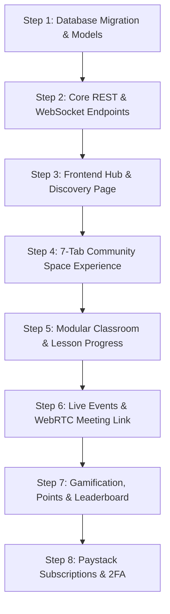

# Akademi Community Replication & Implementation Guide
**Guide Code:** REPL-COMM-01  
**Target:** Replicating the Skool-Style Interactive Community & Masterclass Hub  

This document provides practical, step-by-step instructions and code patterns to replicate the Akademi Community subsystem in a new or existing application.

---

## 1. Quick Start Architecture Stack

To replicate the system with high fidelity:
- **Frontend**: React 18/19 or Next.js 14/15, Tailwind CSS v3 or v4, Lucide React (icons), Framer Motion (animations).
- **Backend Options**:
  - *Option A (Node.js)*: Express / NestJS + Prisma ORM + PostgreSQL.
  - *Option B (PHP)*: Laravel 11/12 + Eloquent + MySQL + Laravel Reverb (WebSockets).
  - *Option C (Python)*: FastAPI + SQLAlchemy + PostgreSQL.
- **Payment Processing**: Paystack (Cards, USSD, Bank Transfer, Apple Pay, Recurring Subscriptions).
- **Live Video / Classroom**: WebRTC SFU (LiveKit, Mediasoup, or Daily.co) integrated with session IDs.

---

## 2. Step-by-Step Implementation Roadmap



---

## 3. Frontend Core Implementation: `CommunityDetail.tsx`

Below is the clean, modularized structure to build the 7-Tab space in React:

```tsx
import React, { useState } from 'react';
import { 
  Users2, MessageSquare, BookOpen, Calendar, 
  Award, Bot, Settings, Heart, Share2, CheckCircle2 
} from 'lucide-react';

type TabType = 'community' | 'classroom' | 'events' | 'experts' | 'leaderboard' | 'ai' | 'studio';

export default function CommunityDetail({ communityId }: { communityId: string }) {
  const [activeTab, setActiveTab] = useState<TabType>('community');
  const [isMember, setIsMember] = useState(false);

  return (
    <div className="min-h-screen bg-[#F8FAFC]">
      {/* 1. Hero Banner & Identity */}
      <div className="bg-white border-b border-slate-200">
        <div className="h-48 md:h-64 w-full relative overflow-hidden bg-slate-900">
          
        </div>

        <div className="max-w-7xl mx-auto px-4 sm:px-6 lg:px-8 py-5">
          <div className="flex flex-col md:flex-row items-start md:items-center justify-between gap-4 -mt-16 md:-mt-20 relative z-10">
            <div className="flex items-center gap-4">
              
              <div>
                <div className="flex items-center gap-2">
                  <h1 className="text-2xl font-bold text-slate-950">Data Analytics Career Hub</h1>
                  <span className="p-1 bg-emerald-100 text-emerald-800 rounded-full text-xs">
                    <CheckCircle2 className="w-4 h-4" />
                  </span>
                </div>
                <p className="text-sm text-slate-600">342 active members • Led by Ade Adeyemi</p>
              </div>
            </div>

            {/* Action Buttons */}
            <div className="flex items-center gap-3">
              <button 
                onClick={() => setIsMember(!isMember)}
                className={`px-6 py-2.5 rounded-xl font-bold text-sm shadow-sm transition-all ${
                  isMember 
                    ? 'bg-slate-100 text-slate-700 hover:bg-slate-200' 
                    : 'bg-[#0F5338] text-white hover:bg-[#0A3D29]'
                }`}
              >
                {isMember ? 'Joined (Member)' : 'Join Community • ₦4,500/mo'}
              </button>
            </div>
          </div>

          {/* 2. Responsive 7-Tab Navigation Bar */}
          <div className="flex items-center gap-2 mt-6 border-t border-slate-100 pt-3 overflow-x-auto no-scrollbar">
            {[
              { id: 'community', label: 'Community', icon: MessageSquare },
              { id: 'classroom', label: 'Classroom', icon: BookOpen },
              { id: 'events', label: 'Calendar & Live', icon: Calendar },
              { id: 'experts', label: 'Tutors & TAs', icon: Users2 },
              { id: 'leaderboard', label: 'Leaderboard', icon: Award },
              { id: 'ai', label: 'Maya AI Bot', icon: Bot },
              { id: 'studio', label: 'Creator Studio', icon: Settings },
            ].map(tab => {
              const Icon = tab.icon;
              const isActive = activeTab === tab.id;
              return (
                <button
                  key={tab.id}
                  onClick={() => setActiveTab(tab.id as TabType)}
                  className={`flex items-center gap-2 px-4 py-2 rounded-xl text-xs font-bold transition-all whitespace-nowrap ${
                    isActive 
                      ? 'bg-[#0F5338] text-white shadow-sm' 
                      : 'text-slate-600 hover:bg-slate-100'
                  }`}
                >
                  <Icon className="w-4 h-4" />
                  {tab.label}
                </button>
              );
            })}
          </div>
        </div>
      </div>

      {/* 3. Tab Body Container */}
      <main className="max-w-7xl mx-auto px-4 sm:px-6 lg:px-8 py-8">
        {activeTab === 'community' && <CommunityFeedSection />}
        {activeTab === 'classroom' && <ClassroomModuleSection />}
        {activeTab === 'events' && <LiveEventsSection />}
        {activeTab === 'experts' && <ExpertsDirectorySection />}
        {activeTab === 'leaderboard' && <LeaderboardSection />}
        {activeTab === 'ai' && <AiMayaSection />}
        {activeTab === 'studio' && <CreatorStudioSection />}
      </main>
    </div>
  );
}
```

---

## 4. Paystack Subscription Integration Flow

To handle recurring community memberships in Nigerian Naira:

```javascript
// Example Paystack Payment Initialization in Node/Express
import axios from 'axios';

export async function initializeCommunitySubscription(req, res) {
  const { communityId, userEmail, userName, amount } = req.body;

  try {
    const response = await axios.post(
      'https://api.paystack.co/transaction/initialize',
      {
        email: userEmail,
        amount: amount * 100, // Paystack requires amount in Kobo
        currency: 'NGN',
        callback_url: `${process.env.APP_URL}/dashboard/communities/${communityId}?payment=success`,
        metadata: {
          communityId,
          userName,
          transaction_type: 'community_membership_subscription'
        }
      },
      {
        headers: {
          Authorization: `Bearer ${process.env.PAYSTACK_SECRET_KEY}`,
          'Content-Type': 'application/json'
        }
      }
    );

    return res.status(200).json({ 
      authorization_url: response.data.data.authorization_url,
      reference: response.data.data.reference 
    });
  } catch (error) {
    return res.status(500).json({ error: error.message });
  }
}
```

---

## 5. WebRTC Masterclass Meeting Room Integration

When a student clicks "Join Live Room" in the Events tab, route them directly into the full-screen interactive meeting room:

```typescript
// Link generation helper
export function generateClassroomMeetingLink(eventId: string, communitySlug: string) {
  const sessionId = `meeting-${communitySlug}-${eventId}`;
  return `/classroom/${sessionId}`;
}
```
Inside `/classroom/:sessionId`:
- Connects to WebRTC SFU with adaptive bitrate (250 kbps – 1.8 Mbps).
- Features full HD 1-on-1 and 8-grid video layouts.
- Interactive whiteboard, chat, screen share, and session recording to Cloud Vault.
